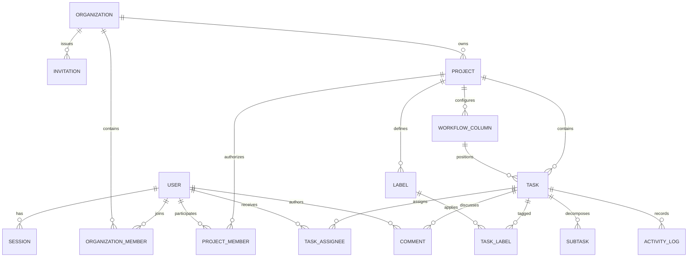

# SyncFlow Architecture

## 1. Architecture summary

SyncFlow will be a TypeScript monorepo containing a Next.js web application and a modular NestJS API backed by PostgreSQL through Prisma. The initial backend is a **modular monolith**, not a set of microservices. This matches the proposal, minimizes operational overhead, and preserves clean module boundaries that can be extracted later if measured scale or team ownership justifies it.

The MVP uses synchronous HTTPS/REST for commands and queries. Socket.IO, Redis/BullMQ, object storage, and a worker process are planned extension points and are introduced only after the persisted MVP workflows are stable.

```mermaid
flowchart LR
    Browser[Next.js browser UI] -->|HTTPS / REST| API[NestJS modular API]
    Browser -. Phase 2: Socket.IO .-> API
    API --> Prisma[Prisma data access]
    Prisma --> PG[(PostgreSQL)]
    API -. Phase 2: private files .-> S3[(S3-compatible storage)]
    API -. Phase 2/3: jobs and fan-out .-> Redis[(Redis)]
    Redis -.-> Worker[NestJS worker]
```

## 2. Architectural principles

1. **Tenant scope is a data invariant.** Authorization is enforced in the API and supported by database constraints, composite keys, and tenant-aware query APIs.
2. **The server is authoritative.** The client may optimistically render interactions, but it reconciles with API results and re-fetches after conflicts or WebSocket reconnects.
3. **Modules own behavior, not infrastructure.** Business rules live in application/domain services; controllers, gateways, Prisma, email, and storage are adapters.
4. **Contracts are explicit.** REST DTOs/OpenAPI and generated client types provide the cross-application boundary. Prisma models are not API contracts.
5. **Transactions protect workflows.** Membership acceptance, project initialization, task moves, activity records, and ownership changes are atomic.
6. **Advanced infrastructure is earned.** Redis, workers, and object storage are added when their corresponding scoped feature begins.

## 3. Monorepo design

### 3.1 Recommended tooling

- **Package manager:** npm workspaces with a committed lockfile for deterministic installs and native workspace commands.
- **Task orchestration:** root npm scripts coordinate workspace lint, test, build, and development tasks; a dedicated cache/orchestrator can be added when CI timings justify it.
- **Formatting/linting:** Prettier and ESLint with shared packages.
- **API contract:** NestJS OpenAPI generation; generate a typed web client from the published schema.
- **Testing:** Vitest or Jest for web/unit tests, Jest + Supertest for NestJS, and Playwright for end-to-end tests. Using Jest throughout is also acceptable; one choice should be standardized before scaffolding.

The npm workspace choice is a project decision that replaces the proposal-stage pnpm/Turborepo assumption. It keeps the foundation on built-in npm capabilities; Nx or Turborepo would provide stronger caching and dependency rules, but their additional conventions are unnecessary for the expected single-developer/small-team scope today.

### 3.2 Repository structure

```text
syncflow/
├─ apps/
│  ├─ web/                    # Next.js application
│  ├─ api/                    # NestJS modular monolith
│  └─ worker/                 # Phase 2/3 NestJS job consumer
├─ packages/
│  ├─ api-client/             # Generated OpenAPI client/types
│  ├─ database/               # Prisma schema, migrations, seed, client factory
│  ├─ ui/                     # Shared shadcn/ui-based design system
│  ├─ validation/             # Truly shared schemas/constants, no business services
│  ├─ eslint-config/
│  ├─ typescript-config/
│  └─ test-config/
├─ tooling/
│  ├─ docker/                 # Container entrypoints/configuration
│  └─ scripts/                # Repository maintenance scripts
├─ docs/
├─ .github/workflows/
├─ docker-compose.yml
├─ package.json               # npm workspace configuration and root scripts
└─ package-lock.json          # reproducible workspace dependency graph
```

The `worker` application is absent from the MVP implementation or remains an empty planned boundary; it must not become a second copy of business rules. Job payloads invoke shared application use cases through deliberately exported backend libraries or a defined internal API.

## 4. Frontend architecture

### 4.1 Folder structure

```text
apps/web/
├─ src/
│  ├─ app/
│  │  ├─ (public)/
│  │  │  ├─ login/
│  │  │  ├─ register/
│  │  │  └─ reset-password/
│  │  ├─ (app)/
│  │  │  ├─ select-workspace/
│  │  │  └─ org/[orgSlug]/
│  │  │     ├─ layout.tsx
│  │  │     ├─ settings/
│  │  │     └─ projects/[projectKey]/
│  │  │        ├─ board/
│  │  │        ├─ tasks/
│  │  │        └─ settings/
│  │  ├─ error.tsx
│  │  └─ layout.tsx
│  ├─ features/
│  │  ├─ auth/
│  │  ├─ organizations/
│  │  ├─ projects/
│  │  ├─ tasks/
│  │  ├─ boards/
│  │  ├─ comments/
│  │  └─ notifications/       # Phase 2
│  ├─ components/
│  │  ├─ ui/                  # App-level shadcn wrappers
│  │  └─ layout/
│  ├─ lib/
│  │  ├─ api/                 # Server/browser API adapters
│  │  ├─ auth/
│  │  ├─ query/
│  │  └─ utils/
│  ├─ hooks/
│  ├─ styles/
│  └─ test/
├─ public/
└─ next.config.ts
```

### 4.2 Frontend responsibilities

- Next.js App Router layouts establish authenticated and organization/project navigation shells.
- Server Components handle initial reads when they improve performance and do not expose credentials; Client Components handle forms, board drag-and-drop, dialogs, and live updates.
- A query/cache library such as TanStack Query manages client mutations, invalidation, optimistic board rendering, and retry behavior. Next.js request caching must be disabled or carefully tagged for user/tenant-specific data to prevent cross-user cache leakage.
- React Hook Form plus a schema validator may manage client feedback, while the NestJS API remains the validation authority.
- Route parameters (`orgSlug`, `projectKey`) are locators, never proof of authorization.
- The board must expose keyboard controls in addition to pointer drag-and-drop.
- The UI package owns visual primitives and tokens; feature folders own business-oriented composition.

## 5. Backend architecture

### 5.1 Folder structure

```text
apps/api/
├─ src/
│  ├─ main.ts
│  ├─ app.module.ts
│  ├─ config/
│  ├─ common/
│  │  ├─ auth/                # Global guards/decorators/principal types
│  │  ├─ errors/
│  │  ├─ filters/
│  │  ├─ interceptors/
│  │  ├─ logging/
│  │  └─ validation/
│  ├─ infrastructure/
│  │  ├─ database/
│  │  ├─ email/
│  │  ├─ events/
│  │  ├─ health/
│  │  ├─ storage/             # Phase 2
│  │  └─ queue/               # Phase 2/3
│  └─ modules/
│     ├─ auth/
│     ├─ users/
│     ├─ organizations/
│     ├─ invitations/
│     ├─ projects/
│     ├─ workflows/
│     ├─ tasks/
│     ├─ comments/
│     ├─ activity/
│     ├─ notifications/       # Phase 2
│     ├─ attachments/         # Phase 2
│     ├─ sprints/             # Phase 2
│     └─ automation/          # Phase 3
└─ test/
   ├─ integration/
   ├─ contract/
   └─ fixtures/
```

Each module should normally contain:

```text
tasks/
├─ application/               # Use cases, command/query services, ports
├─ domain/                    # Policies, value objects, pure rules
├─ infrastructure/            # Prisma repository/adapters
├─ presentation/              # Controllers, DTOs, serializers
├─ tasks.module.ts
└─ *.spec.ts
```

This is pragmatic domain-oriented layering rather than strict ceremonial Clean Architecture. Small modules may combine folders until complexity warrants separation, but controllers must not contain authorization-sensitive business workflows.

### 5.2 Module boundaries

| Module | Owns | May depend on |
| --- | --- | --- |
| Auth | Credentials, sessions, login/reset flows | Users, email adapter |
| Organizations | Organization lifecycle, memberships, roles, ownership | Users, activity |
| Invitations | Invite issuance/acceptance | Organizations, email adapter |
| Projects | Project lifecycle and project memberships | Organizations, workflows, activity |
| Workflows | Columns, ordering, transition rules | Projects, activity |
| Tasks | Tasks, assignees, subtasks, labels, moves/search | Projects, workflows, activity |
| Comments | Comment lifecycle/moderation | Tasks, activity |
| Activity | Append-only audit-friendly event records | Shared actor/resource types |
| Notifications | Phase 2 durable user notifications | Outbox/events, Socket.IO |

Cross-module calls use exported application services or domain events, not direct access to another module's private repository.

### 5.3 REST and events

- Use versioned routes such as `/api/v1/...` and generate OpenAPI from controllers/DTOs.
- Use resource-oriented endpoints; preserve the illustrative routes in the proposal while adding consistent organization/project context where it strengthens scoping.
- Return a stable error envelope with machine-readable code, message, correlation ID, and field errors where appropriate.
- Use cursor pagination for large activity/task feeds; simple bounded offset pagination is acceptable for small configuration lists.
- Domain events are initially in-process and transaction-aware. Before events drive external effects, add a PostgreSQL outbox so committed state and messages cannot diverge.
- Socket.IO rooms are derived from verified membership (`org:{id}`, `project:{id}`, `user:{id}`), never joined solely because a client requested a room name.

## 6. Data architecture

### 6.1 Tenancy model

The MVP uses a **shared database and shared schema**. Tenant-owned records carry `organizationId` directly whenever practical, even when it can be inferred through a parent. The controlled duplication enables efficient composite indexes and makes accidental cross-tenant joins harder.

All public IDs are UUIDs. Human-friendly task identifiers combine an immutable project key with a project-local sequence (for example `SYNC-42`). Timestamps are stored in UTC. User-entered due dates must explicitly model whether they are a date-only value or an instant.

### 6.2 Core entities

| Entity | Important fields | Relationships and constraints |
| --- | --- | --- |
| `User` | `id`, normalized `email`, `name`, `passwordHash`, status, timestamps | Email unique; has sessions and memberships. |
| `Session` | `id`, `userId`, hashed refresh/session token, expiry, revoked time, device metadata | Many per user; indexed by user and expiry. |
| `PasswordResetToken` | `userId`, `tokenHash`, expiry, used time | Single-use; token hash unique. |
| `Organization` | `id`, `name`, `slug`, timestamps, archived time | Slug unique; has memberships, invitations, projects. |
| `OrganizationMember` | `organizationId`, `userId`, `role`, joined time | Composite unique `(organizationId, userId)`; role is `OWNER`, `ADMIN`, or `MEMBER`. At least one owner is enforced by transactional policy. |
| `Invitation` | `organizationId`, normalized email, intended role, `tokenHash`, inviter, expiry, accepted/revoked times | Unique active invite policy per organization/email; acceptance creates membership transactionally. |
| `Project` | `organizationId`, `key`, name, description, metadata, next task number, archived time, version | Unique `(organizationId, key)`; has members, columns, labels, and tasks. |
| `ProjectMember` | `organizationId`, `projectId`, `userId`, role | Unique `(projectId, userId)`; user must also be an organization member. Role is `MANAGER` or `MEMBER`. |
| `WorkflowColumn` | `organizationId`, `projectId`, name, rank, color, archived time | Unique active name/rank policy inside project; owns task placements. |
| `Task` | `organizationId`, `projectId`, `number`, `columnId`, title, description, priority, due date, rank, version, archived time | Unique `(projectId, number)`; composite parent references prevent cross-project/tenant placement. |
| `TaskAssignee` | `organizationId`, `projectId`, `taskId`, `userId` | Unique `(taskId, userId)`; assignee must be an active project member. |
| `Subtask` | `organizationId`, `taskId`, title, completed time, rank, creator | Ordered children of one task. |
| `Label` | `organizationId`, `projectId`, name, color | Unique normalized name per project. |
| `TaskLabel` | `organizationId`, `taskId`, `labelId` | Unique `(taskId, labelId)`; task and label must belong to same project. |
| `Comment` | `organizationId`, `taskId`, author, body, edited/deleted time | Soft deletion preserves conversation and activity linkage. |
| `ActivityLog` | `organizationId`, optional `projectId`/`taskId`, actor, action, entity type/id, safe JSON metadata, timestamp | Append-only through application permissions; indexed for task/project feeds. |

### 6.3 Advanced entities

| Entity | Purpose |
| --- | --- |
| `Notification` | Durable per-recipient event with read state and safe payload. |
| `Attachment` | Task linkage, uploader, original name, MIME type, byte size, checksum, private object key, scan state. |
| `Sprint` / `SprintTask` | Sprint dates, goal, state, capacity/estimate association. |
| `AutomationRule` / `AutomationRun` | Tenant/project-scoped trigger, conditions, actions, run state, and idempotency key. |
| `OutboxEvent` | Reliable publication of committed domain events. |
| `OrganizationPreference` | Typed tenant settings and feature flags. |

### 6.4 Relationship overview



### 6.5 Constraints and indexes

- Use composite foreign keys where supported by the Prisma/PostgreSQL model to prove that children and parents share an organization/project.
- Index every foreign key used for lookup plus `(organizationId, archivedAt)`, project membership lookups, task board ordering `(projectId, columnId, rank)`, due-date filters, activity feeds, and unread notifications.
- Use a lexicographic/fractional rank string or wide numeric gaps for board ordering; rebalance ranks inside a transaction when space is exhausted. Avoid rewriting every task on each drag.
- Increment `Task.version` on mutation and require the client to submit the version for conflict-sensitive updates.
- Use database check constraints for values Prisma cannot adequately constrain and retain them in migrations.
- PostgreSQL row-level security can be evaluated as defense in depth later, but it is not the primary MVP authorization mechanism because request principals and project membership policies remain application concerns.

## 7. Authentication architecture

### 7.1 Session model

Recommended deployment uses a short-lived access token and a rotating refresh token in `HttpOnly` cookies. Refresh token hashes and session-family metadata are stored in PostgreSQL so logout, password reset, reuse detection, and per-device revocation are possible.

1. Registration validates input and hashes the password with Argon2id.
2. Login verifies credentials, applies rate limiting, creates a session, and sets secure cookies.
3. The access token contains only stable identity/session claims, not tenant permissions that can become stale.
4. Refresh rotates both the token and stored hash; reuse revokes the token family.
5. Logout revokes the current session and clears cookies. Password reset revokes all sessions.
6. The API validates trusted origins and CSRF tokens for state-changing cookie-authenticated requests, and uses an explicit CORS allow-list.

Opaque database sessions would simplify revocation and avoid JWT misuse, at the cost of a database/cache lookup on every request. Either is sound; rotating cookies are selected here because they scale to separate web/API processes while preserving server-side revocation. If the web and API cannot share a same-site parent domain, a Next.js backend-for-frontend proxy should be reconsidered instead of weakening cookie policy.

### 7.2 Authorization pipeline

```text
Request
  -> authentication guard resolves Principal(userId, sessionId)
  -> route input validation
  -> organization membership resolution
  -> project membership resolution when project data is involved
  -> policy check for action + resource
  -> tenant-scoped repository query/mutation
  -> safe response serialization and activity record
```

Rules:

- A role decorator alone is insufficient for resource authorization; policies receive the principal and resolved resource context.
- Repository methods that operate on tenant data require a tenant/project scope parameter. There is no unrestricted `findTaskById` in application-facing code.
- Resource lookup and authorization should avoid leaking whether a cross-tenant ID exists; use a non-disclosing `404` where appropriate.
- Background jobs carry immutable actor/tenant/resource identifiers and re-authorize or use narrowly scoped system permissions at execution time.

### 7.3 Permission matrix

| Action | Org Owner | Org Admin | Project Manager | Project Member |
| --- | ---: | ---: | ---: | ---: |
| Change organization settings/ownership | Yes | Limited/No ownership | No | No |
| Invite/manage organization members | Yes | Yes, except owner-only actions | No | No |
| Create a project | Yes | Yes | No, unless org policy later grants it | No |
| Discover/read a specific project | Only if project member | Only if project member | Assigned projects | Assigned projects |
| Manage project settings/members/workflow | If project manager | If project manager | Yes | No |
| Create/update ordinary tasks | If project member | If project member | Yes | Yes |
| Archive project or task | If project manager | If project manager | Yes | No by default |
| Comment | If project member | If project member | Yes | Yes |
| Moderate another user's comment | If project manager | If project manager | Yes | No |

The table is a baseline. Each endpoint still defines an explicit action policy, and the project can later introduce a permission builder without replacing tenant checks.

## 8. Real-time and background architecture (advanced)

- REST mutations commit first; committed domain events are written to an outbox in the same transaction.
- An outbox publisher sends events to Redis/BullMQ and Socket.IO adapters.
- Multiple API replicas use the Socket.IO Redis adapter for fan-out.
- Gateways authenticate during connection and periodically/reconnect-time revalidate memberships.
- Events contain IDs, versions, and minimal safe data. Clients invalidate/re-fetch affected queries instead of treating the event stream as the database.
- Job handlers use idempotency keys, bounded retries, exponential backoff, and visible failed-job handling.
- Attachments use presigned upload/download flows or authorized API streaming; object keys are random and private.

## 9. Deployment architecture

### 9.1 Environments

- **Local:** Docker Compose runs PostgreSQL and a development mail catcher; web/API run in containers or locally. Redis/object storage are opt-in profiles for advanced features.
- **CI:** ephemeral PostgreSQL service, deterministic migrations, test data, and production builds.
- **Preview/staging:** isolated database and secrets; production-like containers; no production data.
- **Production/demo:** independently deployable web and API containers, managed PostgreSQL, TLS, secret manager, backups, and health checks. Add managed Redis/object storage only when required.

### 9.2 Container strategy

- Multi-stage Dockerfiles produce minimal non-root runtime images.
- One image/process has one responsibility: web, API, migration job, and later worker.
- Schema migrations run once as a release job before compatible application rollout, not independently in every replica startup.
- `/health/live` checks the process; `/health/ready` checks critical dependencies with strict timeouts.
- Graceful shutdown drains HTTP/WebSocket connections and closes Prisma cleanly.

### 9.3 Scaling path

The web and API remain stateless and can scale horizontally. PostgreSQL is initially the primary constraint and should be optimized through correct indexes, bounded queries, pooling, and measured read patterns before considering replicas or service extraction. A module becomes a microservice only when there is evidence such as independent scaling needs, strong ownership boundaries, or conflicting reliability requirements.

## 10. Architectural tradeoffs and decisions

| Decision | Benefit | Cost / mitigation |
| --- | --- | --- |
| Modular monolith | Simple deployment, transactions, debugging, and local development | Requires enforced module boundaries to avoid a large coupled application. |
| Shared-schema multi-tenancy | Lowest operational cost and easiest reporting/migrations | A query bug can cross tenant boundaries; require tenant-aware repositories and negative isolation tests. |
| REST first | Clear, testable authoritative workflows | Some over-fetching; defer GraphQL until a demonstrated need. |
| Cookie-based rotating session tokens | Browser-safe credential storage with revocation | Requires careful CSRF, CORS, proxy, and domain configuration. |
| Separate org/project roles | Least privilege and matches proposal | More joins and policy complexity; centralize policy evaluation and test it thoroughly. |
| Optimistic concurrency | Detects stale task updates without pessimistic locks | Clients must handle `409 Conflict` and reload/merge. |
| Socket.IO after MVP | Keeps durable workflows correct before distributed event complexity | MVP collaboration is refresh/poll based; clearly label live behavior post-MVP. |
| Generated OpenAPI client | Prevents hand-maintained frontend/backend contract drift | Generation becomes a CI/build responsibility and generated files need a clear versioning policy. |

## 11. Architecture fitness checks

Architecture remains healthy when:

- dependency checks prevent feature modules from reaching into another module's private infrastructure;
- every tenant repository call requires verified scope;
- cross-tenant negative tests run in CI;
- OpenAPI generation is deterministic and contract changes are reviewed;
- Prisma migrations can build an empty database and upgrade a representative prior database;
- performance tests show bounded query counts for project lists, board loads, and activity feeds;
- the application can run without Redis/object storage while only MVP features are enabled.
